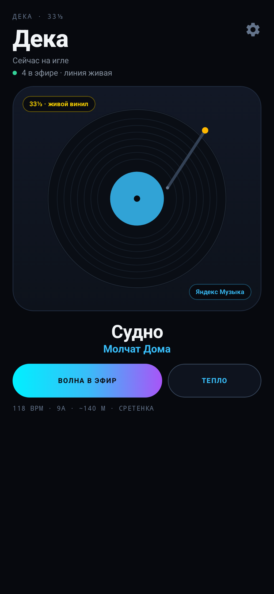

# ЭХО · Android

Сонар музыкального присутствия. Приложение показывает не людей рядом, а музыку,
которая сейчас живёт вокруг, и позволяет тихо на неё откликнуться.

Это новый Android-клиент ЭХО: Compose, Kotlin 2.0, чистая архитектура, без legacy.
Сервер и контракт API — прежние (`echo_server.py`), механика клиента переписана.

## Статус · 0.3.1

Готово:

- четыре экрана канона: **ЭФИР · ДЕКА · ОТЗВУКИ · ТАЙНИКИ** плюс настройки;
- «ЭХО 0.2»: крупные заголовки и метрики, плавающая пилюльная навигация,
  сегментированный переключатель «Сонар / Тайники», редакционные строки сигналов,
  винил в тональной карточке, пилюльные кнопки действий;
- сонар на canvas: кольца, луч, сигналы, призрачные следы, тайники, тепловые пятна,
  точка Лагранжа, шум рассвета; плавающие метки резонанса поверх героя;
- перехват медиа-сессий (Яндекс Музыка, VK, Spotify, YouTube Music, Звук, локальные плееры);
- обложка альбома: берётся из медиа-сессии, показывается на виниле и уходит на сервер;
- автопоиск сервера по UDP и предзаполнение адреса/токена в локальной тестовой сборке;
- «Поделиться → ЭХО» с разбором «Исполнитель — Трек»;
- отклики, волна, синхрон иглы, тепло, встреча;
- тайники: список с радиусом слышимости, звуковой замок, B2B-капсулы заведений;
- виджет «Сейчас играет»: карточка 250×90 на RemoteViews, без сети и сервисов;
- настройки: адрес, токен, зона, присутствие, проверка связи, поиск сервера;
- Compose-превью основных экранов для headless-рендера;
- JVM-тесты на URL, разбор трека, фильтр мусора, парсинг состояния и UDP-пакета.

Дальше: летопись в локальной БД, полный экран паспорта, уведомления об откликах
вне приложения.

Полезное рядом:

- `docs/design/README.md` — дизайн-направления и правила;
- `docs/TOOLING.md` — скилы и MCP-серверы для Android-разработки;
- `docs/CHRONICLE.md` — что и когда менялось.

## Скриншоты 0.2

| ЭФИР | ДЕКА |
|---|---|
|  |  |

Это реальные кадры Compose-превью, а не веб-макеты: `android preview render`.

## Как собрать

Локально нужны JDK 17 и Android SDK 34.

```bat
gradlew.bat assembleDebug
gradlew.bat testDebugUnitTest
```

APK: `app/build/outputs/apk/debug/app-debug.apk`.

Без локального тулчейна сборка идёт через GitHub Actions: workflow `.github/workflows/android.yml`
запускается на push в `main` и складывает APK в артефакты.

> Если путь к проекту содержит кириллицу, на Windows `assembleDebug` работает
> (с `android.overridePathCheck=true`), а JVM-воркер тестов может не найти главный
> класс Gradle. Лечится прогоном из ASCII-пути или в CI.

Debug-сборка подписана общим ключом `keystore/echo-debug.jks` (пароль `echo-debug`),
чтобы обновления ставились поверх предыдущих сборок. Это **не** релизный ключ.

## Быстрый запуск сервера

1. Один раз откройте порт для телефона: двойной клик по `allow-firewall.bat`
   (запросит права администратора).
2. Двойной клик по `run-server.bat`:
   - находит `echo_server.py` в `..\Echo_vinyl` или в локальной папке `server\`;
   - проверяет Python и поднимает сервер на порту из `PORT` (по умолчанию 8080);
   - через 3 секунды открывает пульт `http://127.0.0.1:8080/`.

Без открытия браузера: `run-server.bat --no-browser`.

## Тестовая конфигурация

Локальная сборка читает `echo.defaults.properties` (файл в `.gitignore`):

```properties
echo.host=192.168.0.214:8080
echo.token=<токен из echo_config.json вашего сервера>
```

Значения попадают в `BuildConfig` и сохраняются в настройки при первом запуске.
В репозиторий они не попадают; в CI APK их нет — там приложение ищет сервер по UDP.

> APK из GitHub Actions собирается без `echo.defaults.properties`, поэтому не содержит
> токен. Для теста на телефоне берите локальный `echo-radar-0.3.1-debug.apk`.

## Первый запуск (тестовая сборка)

1. Запустите `run-server.bat`, дождитесь строк «Пульт / Сонар».
2. Установите `echo-radar-0.3.1-debug.apk`.
3. Телефон и ПК — в одной Wi-Fi-сети.
4. Откройте приложение: адрес и токен уже прописаны.
5. Если IP ПК сменился — ⚙ Настройки → **Найти сервер в Wi-Fi**.
6. На ДЕКЕ разрешите доступ к уведомлениям и включите трек в плеере.

Токен нужен для любого запроса не с самой машины сервера, поэтому он уже сохранён
в тестовой сборке. В локальной сети без токена сервер ответит 401.

Приложение не хранит токен в репозитории: только в локальном `echo.defaults.properties`,
BuildConfig тестовой сборки и DataStore устройства.

### Доступ к плееру

На **ДЕКЕ** нажмите «Разрешить доступ» и включите ЭХО в списке доступа к уведомлениям.
После этого смена трека в плеере почти мгновенно уходит в эфир.

Без разрешения работает ручной канал: кнопка «Вручную» или системное «Поделиться → ЭХО».

## Архитектура

```
app/src/main/java/ru/echo/radar/
├── EchoApplication.kt          жизненный цикл, старт/пауза опроса
├── MainActivity.kt             Compose-хост, приём ACTION_SEND
├── di/AppContainer.kt          ручной DI: OkHttp, API, репозиторий
├── domain/
│   ├── model/                  сущности ЭХО (сигнал, капсула, зона, снапшот)
│   └── TrackText.kt            разбор «Исполнитель — Трек», фильтр мусора, пакеты плееров
├── data/
│   ├── remote/                 DTO, OkHttp-клиент, нормализация адреса
│   ├── mapper/                 DTO → домен, защита от странных значений
│   ├── repository/             единственный источник состояния + опрос
│   └── settings/               DataStore, стабильный deviceId
├── media/                      NotificationListener + MediaSession, проверка доступа
└── ui/
    ├── theme/                  токены и типографика ЭХО
    ├── components/             сонар, винил, карточки, шторки, баннер
    ├── screens/                ЭФИР, ДЕКА, ОТЗВУКИ, ТАЙНИКИ, НАСТРОЙКИ
    └── navigation/             четыре вкладки + настройки
```

Правила, которые нельзя ломать:

- **Один источник состояния** — `EchoRepository.snapshot: StateFlow<EchoSnapshot>`.
  Экраны ничего не считают сами: резонанс, BPM, Camelot, расстояния приходят с сервера.
- **Сеть только в IO.** OkHttp вызывается внутри `Dispatchers.IO`, таймауты 5–8 с.
- **Опрос живёт, пока приложение видно.** `EchoApplication` запускает цикл на `ON_START`
  и останавливает на `ON_STOP`. Интервал 2.5 с, после двух ошибок — 7 с.
- **Все запросы сериализованы Mutex**, после каждого действия — один внеочередной опрос.
- **Трек не отправляется дважды**: сравнение идёт по паре «исполнитель + название».
- **Координаты не отправляются.** Сервер размывает место до зоны, клиент показывает
  только зону и примерное расстояние.

## API

Клиент использует тот же контракт, что и веб-версия.

| Метод | Путь | Назначение |
|---|---|---|
| GET | `/api/state?deviceId=` | всё состояние эфира |
| POST | `/api/signal` | трек в эфир |
| POST | `/api/react` | тихий отклик |
| POST | `/api/needle_sync` | синхрон иглы |
| POST | `/api/send_warmth` | тёплое пятно на радаре |
| POST | `/api/wave_impulse` | волна |
| POST | `/api/drop_capsule` | музыкальный тайник |
| POST | `/api/bump_encounter` | запись встречи |
| POST | `/api/delete_signal` | уйти из эфира |
| GET | `/api/cover/<id>` | обложка трека |

Вне домашней сети каждый запрос обязан нести `X-Echo-Token`. Ошибку 401 клиент
показывает как «Токен не принят» и не ретраит бесконечно.

## Стиль

Палитра и типографика — из дизайн-системы ЭХО (`ui/theme`). Сигнальный циан
`#00F0FF` — только для живого; небесный `#38BDF8` — для интерфейса; янтарь
`#FFB800` — тайники и винил; золото `#FFD700` — синхрон и точка Лагранжа.

Тексты — наблюдение, а не реклама. Никаких «Вау!», «Успей!» и восклицательных
знаков пачками.

## Тесты

```bat
gradlew.bat testDebugUnitTest
```

- `EchoUrlTest` — http/https, LAN, туннель, пустой адрес;
- `TrackTextTest` — разбор трека, мусор, allowlist плееров;
- `EchoMappingTest` — полный payload, пустой payload, нештатные значения.

## Приватность

- Нет аккаунтов, лайков, подписчиков и публичных профилей.
- Точное местоположение не показывается и не отправляется.
- Токен и адрес — локально на устройстве.
- Приложение работает в домашней сети без интернета; туннель — опция.
